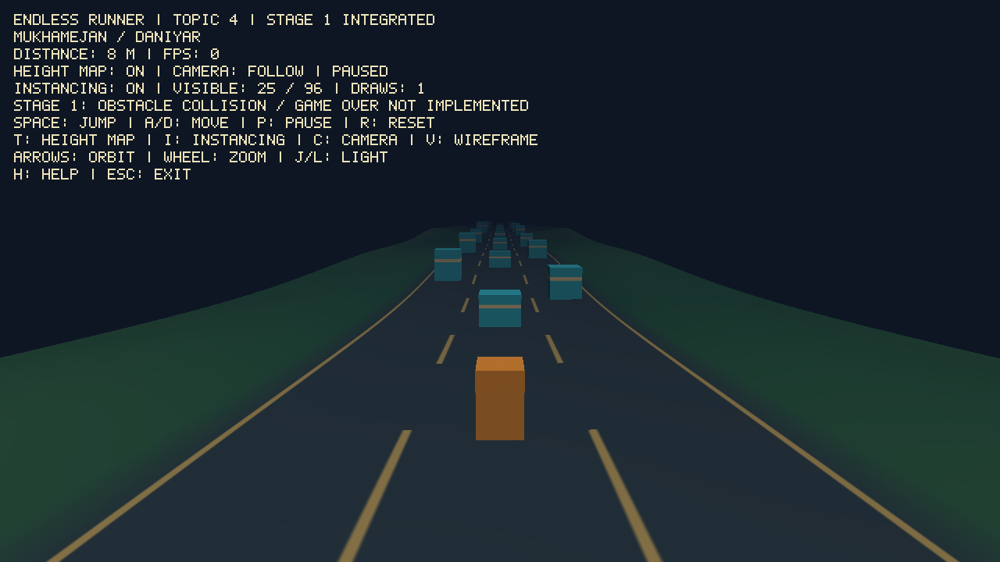

# Endless runner

**Topic 4: Endless runner with instanced obstacles and a height-map ground.**
Astana IT University, Computer Graphics Fundamentals, 2026–2027.

Team: **Mukhamejan Abdikerim / Мухамеджан + Daniyar / Данияр** (confirm Daniyar's full name and group before submission).

The teammate's complete `b461826` revision is integrated with Daniyar's obstacle module in one application. The canonical layout is **`src/` + `shaders/`**. There is one `main.cpp`, one FreeGLUT window and one GLAD loader. The earlier standalone GLFW/GLEW harness is no longer part of the build.



## Status

Implemented: a real height texture sampled in the terrain vertex shader; endless scrolling; player movement/jump and contact with the visible terrain mesh; follow/orbit camera; lit objects; instanced obstacles placed by the same height sampler; bounded obstacle recycling; technique toggles and on-screen help.

Gameplay is complete: the game starts in Ready, collisions with obstacles end the run with a Game Over screen, Enter or R restarts immediately, and the best distance is kept for the session. Collision boxes follow the terrain height and a jump that clears an obstacle does not collide. Speed grows smoothly from 8 to 22 m/s, independent of frame rate. The HUD shows state, score, best, speed, FPS, technique toggles, visible obstacles and draw calls.

## Windows 10/11 — the teammate's existing setup

Use Visual Studio 2022 / MSVC v143, C++17, Windows SDK, FreeGLUT x64, GLAD 1 and GLM. The original `Dependencies.props` paths are preserved. Adjust them for your PC or put matching libraries under `external` as described in that file.

```bat
msbuild EndlessRunner.sln /m /p:Configuration=Release /p:Platform=x64
bin\Release\EndlessRunner.exe
```

Opening `EndlessRunner.sln`, selecting `Release | x64`, and pressing Ctrl+F5 works with the same dependency configuration. The project includes all integrated modules and copies shaders/freeglut.dll to the output. See [START_HERE_RU.md](START_HERE_RU.md). The project file was checked for missing/duplicate source inputs; **MSVC execution was not available in this Linux environment**.

## Linux build

Tested: Debian 13, GCC 14.2, CMake 3.31.6, FreeGLUT 3.4, GLM 0.9.9.8, GLAD generator 0.1.36, Mesa. Requires an OpenGL 3.3 desktop driver and display.

On Debian/Ubuntu, install the toolchain and development packages, then generate GLAD 1 from its bundled Khronos specification:

```sh
sudo apt-get update
sudo apt-get install build-essential cmake ninja-build freeglut3-dev libglm-dev libgl1-mesa-dev libglu1-mesa-dev python3-venv
python3 -m venv .tools
.tools/bin/pip install glad==0.1.36
.tools/bin/python -m glad --profile core --api gl=3.3 --generator c --extensions '' --out-path external/glad --reproducible
cmake -S . -B build -G Ninja -DCMAKE_BUILD_TYPE=Release -DGLAD_ROOT="$PWD/external/glad"
cmake --build build -j 2
ctest --test-dir build --output-on-failure
./build/endless_runner
```

If your package manager names the FreeGLUT development package `libglut-dev`, use that name instead. Existing GLAD 1 files can be supplied with `-DGLAD_ROOT=/path/to/glad`.

## Controls

The game starts in **Ready**: the world stands still until Space or Enter is pressed. A collision switches to **Game Over** and freezes the world; Enter or R starts a new run.

| Key | Action |
|---|---|
| Space | Start from Ready; jump when grounded while running |
| Enter | Start from Ready; restart immediately after Game Over |
| A / D | Move horizontally |
| P | Pause/resume player, ground phase, obstacles and distance together (Running/Paused only) |
| R | Reset player, obstacle pool, distance, phase and speed; Ready and Paused are kept, Running and Game Over start a new run |
| T | Height-map displacement ON/OFF, including player and obstacle ground placement |
| I | Instancing ON: one draw per obstacle type (3) / OFF: one draw for each submitted obstacle |
| C | Follow/orbit camera |
| Arrows / mouse wheel | Orbit / zoom in orbit mode |
| J / L | Rotate light |
| V | Wireframe |
| N | Enter the stress test (96 obstacles), then step up: 250, 500, 1000, 2500, 5000, 10000 |
| M | Stress test: step the obstacle count down |
| B | Leave the stress test and return to the normal game (96-obstacle pool, Ready) |
| H | Help |
| Esc | Exit |

Windows letter polling includes **I**, **N**, **M** and **B** and preserves the teammate's Russian/English keyboard-layout handling. One shared clock advances from **8 m/s** up to **22 m/s**; terrain phase repeats after **128 m**. In normal play obstacles come in rows every 16 m across three lanes; each row blocks one or two lanes with a low barrier (jumpable), crate or column, and always leaves a free lane. The layout is deterministic and gets denser with speed. Only boxes fully inside the terrain Z range are submitted, so the visible count varies. In the stress test (N/M/B or `--instances N`) all N obstacles are placed on the visible terrain, every one is submitted, and collisions are off. The HUD's draw count covers obstacles only.

## Validation / cloud

```sh
bash scripts/setup-cloud.sh
bash scripts/cloud-run.sh --smoke-test --screenshot artifacts/stage1-integrated.ppm
bash scripts/cloud-run.sh --benchmark
```

The rootless setup uses `/workspace/.runner-tools`, signed Debian packages and reproducible GLAD generation. `cloud-run.sh` starts and cleans up a private Xvfb display if needed and uses software Mesa. Existing checkouts are already isolated; do not create a Git worktree unless explicitly requested. Live display/application processes must be restarted in a new task.

Desktop equivalents use `./build/endless_runner --smoke-test` or `--benchmark`. The smoke test exercises the real input-action handlers and terrain shader, compares instancing ON/OFF, checks CPU/GPU heights through transform feedback, and verifies jump/landing, pause/reset, toggles, phase wrapping and resize. CTest has **2 tests, 405 assertions**. [Current validation evidence](docs/STAGE1_INTEGRATED_VALIDATION.md).

The benchmark reports completed render-frame wall times for a fixed scene; no update, instance upload, HUD or buffer swap is timed. It is not a lab-GPU certification. `--instances N` changes pool capacity; terrain-range culling means increasing the pool does not make all instances visible.

## Modules and documents

| Owner | Modules |
|---|---|
| Mukhamejan | HeightField, Player, Camera, terrain/player shaders, initial FreeGLUT renderer and input |
| Daniyar | Game, Obstacles, instanced shaders, movement/recycling/distance |
| Shared integration | main, Renderer, Shader, Keyboard, CMake/Visual Studio, HUD and validation |

- [Current integration contract](docs/INTEGRATION.md)
- [Russian handoff and review](INTEGRATION_DANIYAR.md)
- [Shader explanation](SHADER_NOTES_RU.md) and [Daniyar's defence guide](docs/DANIYAR_GUIDE_RU.md)
- [Current requirements checklist](docs/REQUIREMENTS.md)
- [Earlier standalone report draft](docs/DANIYAR_MIDTERM.md): historical evidence, must be updated with the integrated scene before submission

