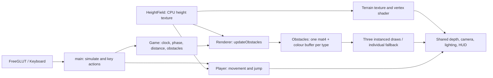

# Integration contract

Base: teammate commit `b461826`. All application source lives in `src/` and all shaders in `shaders/`. `EndlessRunner.vcxproj` and CMake compile the same application modules. The existing Windows `Dependencies.props` paths remain valid. FreeGLUT creates the only window; GLAD 1 loads the only OpenGL API. The old GLEW/GLFW/Hud wrapper is removed from the application.

## Coordinates, time and ground contact

- Right-handed world, +Y up, +X right, −Z forward; player Z = 0, obstacles approach along +Z.
- `Game` owns distance, best score, run state, obstacle positions and bounded phase. Speed grows linearly with running time from **8 m/s** by 0.2 m/s² and is capped at **22 m/s** (reached after 70 s). Distance is the closed-form integral of that speed over the elapsed running time, so 30 FPS and 144 FPS give the same distance and speed. Each update derives one `travel` value that moves the obstacles and advances `groundPhase`. `Game::speed()` is the current world speed and is 0 outside Running; `currentSpeed()` is the run speed shown in the HUD. `Game::GroundPeriod` references `HeightField::period`, currently **128 m**; there is no separate 256 m runtime constant.
- `main::simulate` updates Game once, copies the current phase to renderer/player arguments, updates Player, then calls `Game::checkCollision`. Ready, Paused and GameOver prevent all of these updates. The interactive dt cap is the teammate's 0.05 s.
- Height texture coordinates use `(z - phase) / period`. `Renderer::updateObstacles` calls `terrain.surfaceHeight(x, z, game.groundPhase(), displaced)` with **local z**, not `phase-z` or a second phase subtraction.
- `surfaceHeight` matches texture filtering and the triangles used by the terrain index buffer. The obstacle bottom centre uses this height; centre Y adds half its height. Boxes remain upright; steep-slope corner support is not implemented.
- Player has full dimensions 0.8 × 1.2 × 0.8. `feetY` is the bottom and horizontal motion is clamped to [−4.2,4.2].
- Rendering filters obstacles whose full Z extent would exceed the terrain mesh. Off-terrain pool entries continue moving/recycling but cannot float beyond the end of the mesh. This is terrain-range filtering, not full camera-frustum culling.

## Run states and collision

| State | World | Keys |
|---|---|---|
| Ready | Program start. World, obstacles, score and player stand still; a centred banner asks to start. | Space or Enter starts; R resets and stays Ready |
| Running | World, obstacles, score and speed advance; collisions are checked every update. | Space jumps; P pauses; R starts a fresh run |
| Paused | Everything frozen; jump is blocked. | P resumes; R resets and stays Paused |
| GameOver | Entered on collision. World, obstacles, score, phase and player are frozen; jump and pause are disabled; banner shows score, best and restart hint. | Enter or R starts a new run immediately |

A restart resets the player, obstacle pool, distance, phase, elapsed time and speed. The best distance is kept for the session and is updated on game over and on reset.

`Game::collides(x, feetY, height)` takes the player position and a `GroundHeight` callback (`std::function<float(float,float)>`). The player box is 0.8 × `Player::height` × 0.8 at Z = 0, matching the scaled cube in `Renderer::draw`. Each obstacle box uses the same placement as `Obstacles::upload`: bottom centre at `height(x, z)`, top at that height plus the obstacle height. A collision requires strict overlap on X, Y and Z, so a jump whose feet stay above the obstacle top does not collide. Only obstacles that pass `Game::onTerrain`, the same farZ/nearZ filter used by `Renderer::updateObstacles`, are tested. `main` passes `HeightField::surfaceHeight` with the current phase and displacement flag, so collisions follow the visible terrain. Game has no OpenGL dependency.

At 22 m/s and the 0.05 s interactive dt cap an obstacle moves 1.1 m per step, less than the 1.4 m combined depth of the player and the thinnest obstacle (low barrier, 0.6 m), so it cannot pass through the player between updates.

## Obstacle rows and types

Obstacles come in rows every **16 m** along Z; the first row starts 30 m ahead. There are three lanes at x = -3.2, 0 and 3.2. Every obstacle is **3.0 m** wide, so two neighbouring blocked lanes leave a 0.2 m gap, narrower than the 0.8 m player, and the outer obstacles reach past the ±4.2 m movement limit. There is no safe spot between or beside lanes.

| Type | Name | Size (w × h × d) | Colour | Jump |
|---|---|---|---|---|
| 0 | Low barrier | 3.0 × 0.75 × 0.6 m | yellow | Can be jumped: the jump peak is 7.2² / (2 × 18) = 1.44 m |
| 1 | Crate | 3.0 × 1.6 × 1.6 m | teal | Too high to jump |
| 2 | Column | 3.0 × 3.4 × 1.0 m | red | Too high to jump |

The layout of row `n` is a pure function `Game::rowLayout(n)` of its serial number and the fixed seed `Game::LayoutSeed`, using a splitmix64 hash. There is no `std::random_device` or global random state, so every run and every test sees the same sequence.

- Even rows block one lane chosen by the hash. With a probability that rises with the speed at which the player will reach that row, the lane repeats the one from row `n - 2`.
- Odd rows are derived from their even neighbours. If the neighbours block different lanes, the odd row blocks the third lane. If the neighbours block the same lane, the odd row blocks the **other two** lanes and leaves that lane open.
- Consequently consecutive rows never block the same lane, every row has at least one free lane, and there is always a path that needs at most one lane change between rows. Two-lane rows become more frequent as the speed grows: about 40 % of odd rows at 8 m/s and about 90 % at 22 m/s.
- The type of each blocked lane is drawn from the hash: 40 % low barrier, 35 % crate, 25 % column.

`Game` keeps a ring of row slots. When a slot passes `RecycleZ` it moves back by the loop length and its serial grows by the number of slots, and its layout is rebuilt from the new serial. Because the layout depends only on that serial, recycling stays deterministic and independent of the frame rate.

## Typed instancing

`Obstacles` splits the submitted obstacles by type. Each type has its own VAO and instance buffer holding a `mat4` model matrix (locations 2-5) and a `vec3` colour (location 6), both with divisor 1. The cube mesh and index buffer are shared. With instancing ON there is one `glDrawElementsInstanced` per non-empty type: **3 draw calls** in normal play. With instancing OFF every obstacle is drawn with `glDrawElements` and the `uModel` uniform. Its colour is supplied as a constant generic vertex attribute on location 6, so both paths produce identical pixels. `validateLayout` checks divisor, size, stride and buffer binding of all instance attributes for every type.

## Stress test

The stress mode measures instancing ON/OFF with many obstacles. N enters it with 96 obstacles and then steps through 96, 250, 500, 1000, 2500, 5000 and 10000. M steps back, and B returns to the normal game: 96-obstacle pool, Ready state. In stress mode every obstacle is placed by the same deterministic hash inside the visible terrain, with x in ±10 m and z between `HeightField::farZ` and `nearZ`. The boxes are 0.7 m wide, cycle through the three types and wrap inside that Z range while the world scrolls. All of them are submitted every frame. Collisions are disabled, and the distance never becomes the best score. The world keeps running, P still pauses, R restarts the scroll and I still toggles instancing. The HUD shows the obstacle count, submitted instances, obstacle draw calls (3 or N) and FPS.

`--instances N` starts the application directly in stress mode with N obstacles. `--benchmark [--instances N]` uses the same stress layout and prints `mode,pool,visible,obstacle_draws,...` CSV rows for instancing ON and OFF to the console only.

## Shared input and resources

P freezes distance/phase, player physics and obstacles together and works only from Running. R resets Game and Player and preserves Ready or Paused; from Running or GameOver it starts a fresh run. Enter starts from Ready and restarts from GameOver. Windows passes Enter (13) through the GLUT character callback together with Space and Esc; letters stay on virtual-key polling. T changes both the terrain VS height scale and the CPU ground sampler used by Player and obstacles. I switches draw submission without moving or hiding the obstacles. C retains follow/orbit; it is no longer the old standalone reset-view binding. Space remains jump. Windows virtual-key polling now includes I, N, M and B. N, M and B switch between the normal game and the stress test as described above.

Renderer owns the obstacle program and resources. `Obstacles::initialize()` runs only after a GL context exists; `shutdown()` runs before it is destroyed. The global Renderer constructor performs no GL calls. Obstacles uses the shared `loadProgram`, GLAD and GLuint program API. All shaders stay external. In normal play the HUD shows the topic, team, run state, score, best, speed, FPS, technique toggles, visible obstacles and obstacle draw calls (3 with instancing ON). In stress mode it shows the obstacle count, submitted instances, draw calls and FPS instead. The key list is toggled by H. Ready, Paused and GameOver also draw a large centred banner.

`loadProgram` has an optional transform-feedback varying used to validate positions from the actual terrain vertex shader. Ordinary rendering is unchanged by this link-time option. The smoke test reads all mesh vertices and compares them to the CPU height sampler at several phases and with displacement disabled.

## Ownership

HeightField/Player/Camera and their shaders come from Mukhamejan's Stage 1 commit; Game/Obstacles and obstacle shaders are Daniyar's module. Main, Renderer, Shader, Keyboard and build files now contain integration changes. Source moves are recorded as Git renames; verified pre-integration backups are outside the checkout under `/workspace/review-backups/`.
